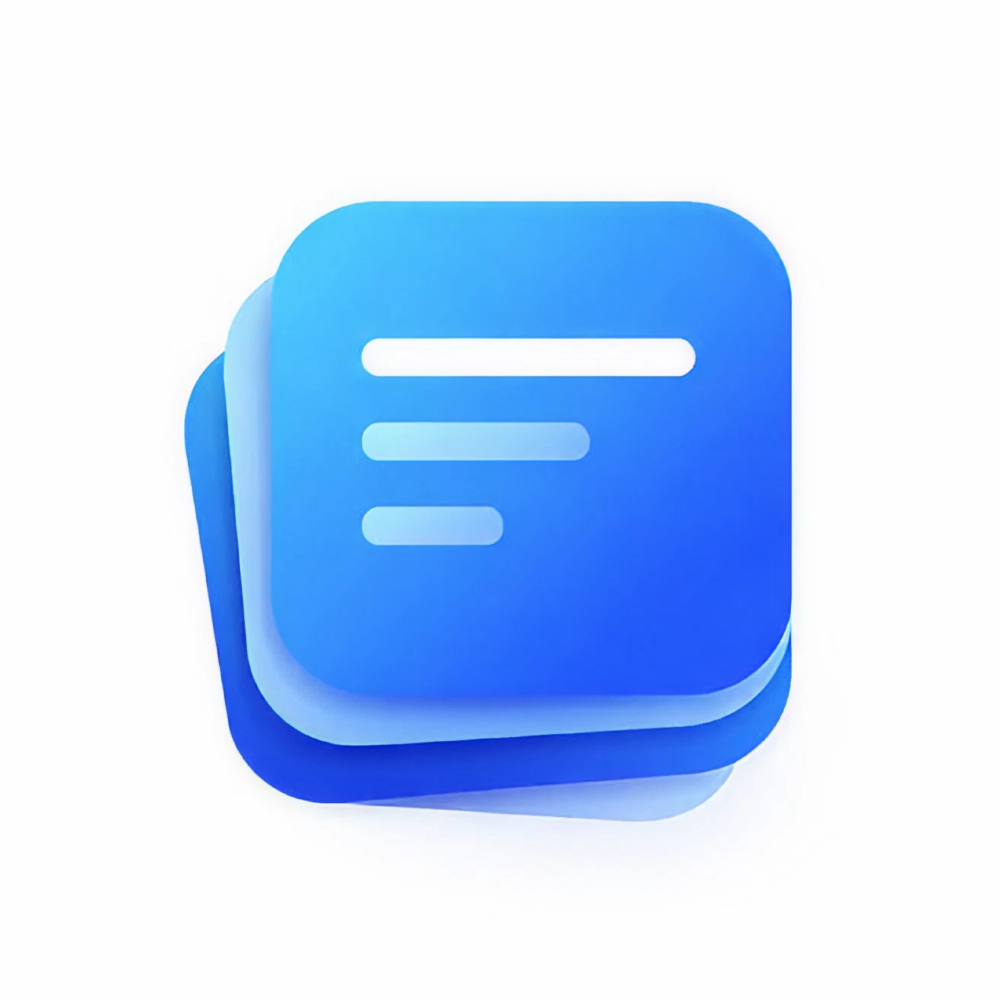

<p align="center">
  
</p>

<h1 align="center">FieldSnap</h1>

<p align="center">
  <b>Photograph an equipment nameplate, get a structured field record back.</b><br>
  An AI field-documentation app for engineers and technicians. Designed and built solo, live on Google Play.
</p>

<p align="center">
  <a href="https://play.google.com/store/apps/details?id=com.koyr.fieldsnap">Google Play</a> ·
  <a href="https://fieldsnap.org">fieldsnap.org</a> ·
  <a href="docs/case-study.md">The case study</a> ·
  <a href="docs/equipment-templates.md">The taxonomy</a> ·
  <a href="docs/architecture.md">Architecture</a> ·
  <a href="docs/design-system.md">Design system</a>
</p>

---

An electrician commissioning a building copies model numbers, serial numbers, voltages, phases and breaker IDs off a few hundred labels by hand, onto a clipboard or a phone note, then types the whole lot again into a spreadsheet back at the office. The data gets transcribed twice and wrong at least once.

FieldSnap replaces the first transcription. Pick the equipment type, photograph the label, and the fields come back filled in — checked, corrected where needed, filed into a project folder, exported as a PDF report.

> **Status: shipped, not scaled.** Live on Google Play under Koyr Studio, with in-app purchases configured; last updated April 2026. **10+ installs.** This is a finished product that went through Google Play's review and policy process end to end — it is not a business, and nothing here should be read as traction.

<!-- SCREENSHOTS: drop images into assets/screenshots/ and uncomment.
<p align="center">
  
</p>
-->

---

## The problem is not reading the label. It's knowing what the label means.

Any vision model will read the text off a nameplate. That part took an afternoon.

The product question is what to do with it — and the answer differs for every kind of equipment in a building. A transformer's identity is its primary voltage, secondary voltage and KVA rating. An elevator controller's is floor count, car capacity and drive type, where drive type is a closed set of four. A VFD, a chiller and a patch panel share almost no fields at all.

So extraction is never open-ended. You choose the equipment type first, and that choice supplies the schema the model is asked to fill:

| Category | Types | Example fields |
|---|---|---|
| **Electrical Panels** | 6 | Panel ID · breaker number · amperage · voltage · phase |
| **HVAC Equipment** | 6 | Tonnage · refrigerant type · airflow · unit ID |
| **Power Systems** | 5 | KVA rating · battery type · transfer time · array voltage |
| **Motors & Drives** | 4 | Horsepower · RPM · frame size · service factor |
| **Telecom / Data** | 4 | Rack units · port count · switching capacity |
| **Others** | 3 | Zone count · floors served · car capacity |

**28 equipment types · 179 typed fields · 6 categories.** Every field carries a real placeholder — `e.g. 480V`, `e.g. Square D`, `e.g. 750 KVA` — rather than a generic hint, because the placeholder is what tells a technician which of the four numbers on a nameplate belongs in that box. Fields use `text`, `number`, `date` or `select` types. Most nameplate values are strings; elevator drive type is an example of a closed-domain `select` (Traction, Hydraulic, MRL, Pneumatic). See the linked taxonomy for the field inventory.

The taxonomy came from desk research: manufacturer nameplate documentation and trade forums where electricians, HVAC techs and facilities engineers argue about what actually needs recording. It is the part of the product that is hardest to copy, and the part a general-purpose "scan anything" tool gets wrong.

**→ [The full 28-template taxonomy](docs/equipment-templates.md)**

---

## Three decisions worth defending

**1. You can use the whole app before you have an account — and lose nothing when you make one.**

A technician standing in a plant room will not create an account to find out whether an app works. So guest mode isn't a demo: it is the full product, writing to local storage under a guest key.

The interesting part is the seam. When a guest signs up, `migrateGuestDataToUser()` reads the guest store, prepends it to the new account, then clears the guest key so nothing imports twice. `signIn()` **awaits that migration before flipping auth state**, so the data provider remounts with the folders already in place. The alternative — flip auth, then migrate — briefly renders an empty home screen to someone who has just spent an hour scanning a substation.

**2. Never show a price you can't confirm.**

Subscription prices come from the store, per country, through RevenueCat. They are never hardcoded into the UI.

If the store is slow, the price cell shows a spinner. If the store can't be reached, the cell stays **blank**, and the buy button reads *Currently unavailable* and is disabled. There is a hardcoded USD fallback in the service layer, and the screen deliberately refuses to render it.

The lazy version shows `$19` to everyone and lets the payment sheet correct it. That means a technician in Lagos or Warsaw reads a number that isn't their price, taps buy, and finds the real one at the till. Showing nothing looks worse and is more honest, and honesty is the right trade for a price.

**3. Capping Android's font scale — and taking responsibility for what replaces it.**

Android lets users scale system text to 200%. Inherited blindly, that breaks every fixed-height container in the app — nameplate data is dense, tabular and unforgiving of reflow.

FieldSnap sets `maxFontSizeMultiplier: 1` globally, which overrides the OS setting. That is only defensible if something replaces it, so the app ships its own appearance suite: light/dark/follow-system, three text sizes, bold text, high contrast, reduce motion — six settings, persisted, applied through the theme rather than bolted onto individual screens. The text scale alone is referenced **321 times across 38 files**; reduce motion is honoured in 12.

It is an explicit trade: a legibility model the app fully controls, instead of one it partially honours and partially breaks. It is also incomplete, and the honest notes below say where.

---

## Shipping was a design constraint

Google Play's Photo & Video Permissions policy forbids `READ_MEDIA_IMAGES` and `READ_MEDIA_VIDEO` unless persistent media-library access is the app's **core purpose**. FieldSnap only needs to pick one photo at a time and save snapshots to the gallery — neither requires those permissions.

The media-library dependency injects them into the manifest anyway, regardless of what the app config asks for — a policy violation written into the build output, with no fix available at the app-config layer.

The fix is a custom Expo build plugin, `withRemoveMediaPermissions`, that filters those permissions out of the generated `AndroidManifest.xml` — while keeping `READ_MEDIA_VISUAL_USER_SELECTED`, which is Android 14's partial-access model and is policy-safe. It ships with the policy reasoning written into the file, because in six months the reason matters more than the code.

This is the part of "designed and built solo" that doesn't photograph well: reading a store policy, working out why a dependency violates it, and meeting it at the build layer.

---

## How it works

```
  Choose equipment type          Camera                  Gemini Vision
     (28 templates)     →   video + snapshots   →   ┌────────────────┐
                                                    │   raw OCR      │ ──→  OCR tab
                                                    │   field fill   │ ──→  Smart Data tab
                                                    └────────────────┘
                                                             ↓
                                       Review · correct · add notes · name it
                                                             ↓
                                     Folder → Division → Scan   (written locally first)
                                                             ↓
                            debounced sync  ──→  Postgres + object storage
                                                             ↓
                                     Typeset PDF        Deep-link share
```

Two AI passes, deliberately kept separate. **Raw OCR** returns everything visible on the label, verbatim — the escape hatch for when structured extraction misses something. **Structured extraction** is prompted with the chosen template's exact field keys and returns JSON constrained to them, with empty strings where the label is unreadable rather than invented values. The two sit in adjacent tabs on the review screen, so a technician can always see what the camera actually saw.

Records are local-first. Everything works with no signal; sync is a 4-second debounce after any change, with timeouts on every network boundary and a three-level merge on restore.

**→ [Architecture in detail](docs/architecture.md)**

---

## What I designed and built

Everything, solo — the product, the taxonomy, the design system, the app, the backend, the store listing and the marketing site. Every commit is sole-authored.

**Product** — templates-as-schema · desk research into nameplate fields across six equipment categories · guest-first onboarding · the two-pass OCR / structured-extraction split · pricing and packaging.

**Design** — a token-driven design system consumed by 38 files · every screen and flow across 32 routes · light and dark · the six-setting appearance and legibility suite · the icon set, drawn as vectors and shipped as exact SVG paths · a typeset PDF report with real page margins and a running footer · the app icon, store listing and marketing site.

**Engineering** — React Native / Expo · a Gemini Vision extraction pipeline · offline-first storage with debounced cloud sync · Supabase auth (email OTP, Google, Apple), Postgres and object storage · RevenueCat purchase infrastructure · deep links · PDF generation · Sentry · EAS builds and the full Play submission.

*Four honest notes. The git history is checkpointed rather than incremental, so the commit graph badly understates the timeline. There is no automated test suite. The accessibility work covers legibility and motion, but there are no screen-reader labels yet — that is the next accessibility milestone, not a solved problem. And at 10+ installs this is a shipped product with no meaningful usage data behind it.*

---

## Built with

`React Native` · `Expo` · `TypeScript` · `Supabase` (Postgres · Auth · Storage) · `Google Gemini` (Vision) · `RevenueCat` · `Sentry` · `EAS Build`

App source is private. → **[github.com/heykoyr/fieldsnap](https://github.com/heykoyr/fieldsnap)**

---

## This repository

Two things live here:

| | |
|---|---|
| **The case study** | This README and [`docs/`](docs) — the product, the taxonomy, the architecture and the design system. Read on GitHub. |
| **The marketing site** | `index.html` and `privacy/` — hand-written static HTML and CSS, no framework and no build step. Served from GitHub Pages at [fieldsnap.org](https://fieldsnap.org). |

The two are kept apart at build time: `_config.yml` excludes the case-study documents from the published site, so the domain serves only the marketing pages.

---

<p align="center">
  Designed and built by <b>Adekoya Oluwafemi</b> — a product of <b>Koyr</b>.<br>
  <a href="https://fieldsnap.org">fieldsnap.org</a>
</p>
